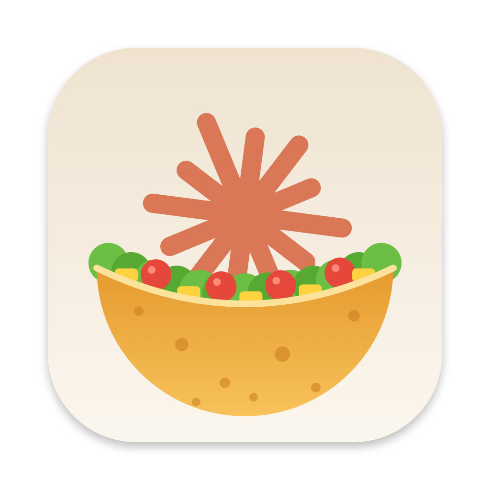

<p align="center"></p>

# Notch Us 🌮

> *"You've reached your usage limit."* — Claude, right when things were getting good.

Your MacBook's notch was just sitting there doing nothing. Now it does something useful:
it tells you how close you are to getting rate-limited by Claude Code, **before** it happens.

**Notch Us** is a tiny macOS menu bar + notch app that shows your Claude Code **session (5h)** and **weekly** usage limits at a glance.
Because the notch notches us, and Claude limits us. Notch us. (Say it fast. Yes, like nachos 🧀)

## What it shows

- **Session limit (5h)** and **weekly limit**: how much you've used and when it resets
- **Local token counts**, read from your own Claude Code session logs
- Lives in the menu bar and (optionally) hangs out around the notch

## How it works

- Limits: `GET https://api.anthropic.com/api/oauth/usage`, using the OAuth token Claude Code already keeps in your keychain (`Claude Code-credentials`).
- Local token counts: parsed from `~/.claude/projects/**/*.jsonl`.

Nothing leaves your machine except that single request to Anthropic. No analytics, no servers, no nonsense.

> The first time it reads the keychain, macOS will ask for permission. That's expected. Click "Always Allow" if you don't want to see the prompt again.

## Install

Requires macOS 14+ (Apple Silicon or Intel). You need to be logged in to Claude Code (`claude` → `/login`) so the token is in the keychain.

### Homebrew (recommended)

```sh
brew install --cask semihozsoy/tap/notch-us
```

### One-liner

```sh
curl -fsSL https://raw.githubusercontent.com/semihozsoy/notch-us/master/install.sh | sh
```

Downloads the latest release, puts it in `~/Applications` and opens it.

Either way, the app checks for new releases and updates itself from the menu. On v1.2.0 or older? Run the one-liner once; from v1.3.0 on, it tells you.

### Manual download

Grab `NotchUs.zip` from the [latest release](https://github.com/semihozsoy/notch-us/releases/latest), unzip it and move `NotchUs.app` to Applications.

The app isn't notarized by Apple (that costs $99/year, and we spent it on tacos 🌮), so macOS will block it the first time.
To open it anyway: try to open it once, then go to **System Settings → Privacy & Security** and click **Open Anyway**.

### Build from source

Requires the Xcode Command Line Tools (`xcode-select --install`).

```sh
git clone https://github.com/semihozsoy/notch-us.git
cd notch-us
./build.sh            # builds build/NotchUs.app
./build.sh --install  # also installs to ~/Applications and launches it
```

### Releasing

Push a version tag and GitHub Actions builds a universal app and publishes the release:

```sh
git tag v1.0.0 && git push origin v1.0.0
```

## Disclaimer

This is an unofficial, community-made project. It is not affiliated with or endorsed by Anthropic.
It uses an undocumented endpoint, so it may stop working one day without warning. If it does, PRs are welcome 🙏

## Contributing

Issues and PRs are welcome. If it made you laugh, a star wouldn't hurt either ⭐

## License

[MIT](LICENSE)
